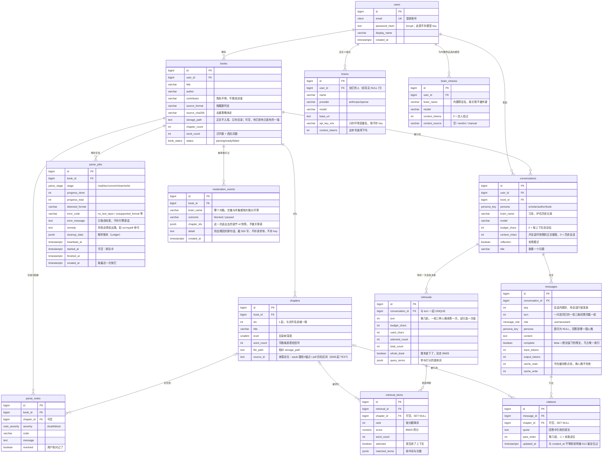

# 数据库 ER 图

> **本文档职责**：用 Mermaid `erDiagram` 语法展示实体-关系（ER）图，并对每个实体及其关系作简要描述。
> 详细的表关系基数说明见 `database-relations.md`，建表 SQL 见 `sql.md`。

## ER 图

## 实体简要描述

**账号域**

- **`users`** —— 账号。全库唯一不存任何模型 API key 的设计中心：key 只在用户浏览器 localStorage，请求时经 `X-Brain-Key` 头带来，后端用完即丢。

**解析域**（图中左上，对应界面稿 ①②③④）

- **`books`** —— 一本已入库的书。存元信息与磁盘路径，**不存正文**。`status` 三态驱动书库卡片的三种外观：解析中（靛）、就绪（不着色）、停下了（重墨）。`storage_path` 解析成功才写上：有它就是「有已发布的一版」——重解析中、重解析失败之后照读那一版，与 `status` 一起构成门表的两半（能不能读 / 问 / 重解析）。
- **`chapters`** —— 章节索引。`word_count` 不只是统计，它是质检工具：异常短的章节（如只有 5 字的「第一部」）在目录树上标黄，提示用户点开核对是分部标题页还是丢了正文。
- **`parse_jobs`** —— 一次解析的阶段与进度，经 SSE 推给前端画进度条。失败时 `error_code` + `remedy` 一起给出——扫描版 PDF 抽不出文字要给 OCR 命令，而不是写出一个空 md 假装成功。给人看的那句（`error_message`）只取自码表，对外也按 `error_code` 映射；引擎原话只进服务端日志。`cleanup_stats` 是解析账本，存储格式由 `services/ledger.py` 的 `Ledger` 一处读写。
- **`parse_notes`** —— 解析产生的存疑与阻断条目，来自引擎的 `Book.warnings`。`resolved` 记录用户是否已核对。这张表存在的意义是：解析成功不等于解析正确。

**对话域**（图中右下，对应界面稿 ⑤⑥⑦⑧）

- **`brains`** —— 用户自己加的 OpenAI 兼容端点。**内置预设（claude / qwen / deepseek / kimi / glm / siliconflow / openai / ollama / lmstudio）不在这张表里**，真相在引擎的 `booksoul.config`——`user_id` 可空是 `0001` 的历史设计，实际没有 `NULL` 行。`api_key_env` 只是个名字，用来在设置页提示「需要哪个 key」。`context_tokens` 用来回答「这本书装得进这个大脑吗」；换模型时直接改这一行。
- **`brain_choices`** —— 用户为内置预设换的模型与窗口（迁移 `0004`）。解析 = 预设 + 选择：provider / 地址 / key 名永远从代码来，这张表只覆盖模型与窗口，所以连放地址的列都没有。与预设按名字弱关联：预设改名或删掉，对不上的行被忽略。`context_source` 记窗口是供应商报的还是用户填的，下次打开⑧屏还说得出来路。
- **`conversations`** —— 一次读书对话，锁定书 + 人格 + 大脑三者。`brain_name`、`model` 与 `context_chars`（开会话时的正文额度，迁移 `0003`）都在开会话时锁下：日后改了预设或换了模型选择，已落库的消息不会被篡改来源，**这个会话的下一轮也仍按开的时候那个模型调用、按那个额度挑章节**（提问时用快照的模型覆盖当下配置）。
- **`messages`** —— 消息与 token 用量。`cache_read` 单独一列是因为系统提示的拼装顺序刻意为之——框架语 → 全书 →（缓存断点）→ 人格，换人格时整本书的缓存仍然命中，这一列能直接看出省了多少。
- **`retrievals` / `retrieval_items`** —— 选章决策及其逐章明细。**这是本 schema 里最不寻常的一对**：它把「模型这次到底读了哪几节」变成可查的记录。`retrieval_items` 为全书每一节都留一行（含未选中的），所以界面上能画出完整排名表和那条预算线——包括「下一节差 504 字装不下」这种具体到字数的解释。
- **`citations`** —— 溯源。回答里的引文落库时与**这一轮真载入的那几节的原始文件**比对，定位到块序号；对不上就填 `-1`，不猜。阅读页据此跳转并高亮。重解析之后会尝试重新定位（S12 的 CitationRelocator），`updated_at != created_at` 即说明这条是事后找回来的，界面据此区分。
- **`moderation_events`** —— 内容审核台账（S13）。供应商拒绝时只回一个 400，不说是哪一段触发的；但「这一次送了哪几节、结果是拦还是通」是我们自己的账。**嫌疑 = 被拦时都在场的那几节（交集） − 曾经平安送过去的那几节（并集）**，收窄到一节就在④屏给那一节挂重墨。两种证据都来自用户本来就要发的请求，不必为了定位再多花一次调用。

**两处刻意的 `SET NULL`**

`retrieval_items.chapter_id` 与 `citations.chapter_id` 用 `ON DELETE SET NULL` 而非 `CASCADE`。重新解析一本书会删掉旧的 `chapters` 行重建，若用 CASCADE，用户过去所有对话的检索留档与溯源会被一次重解析清空。降级为「原章节已变更」是可接受的，凭空消失不是。
